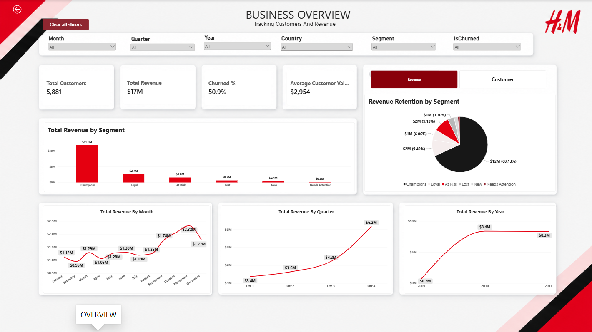
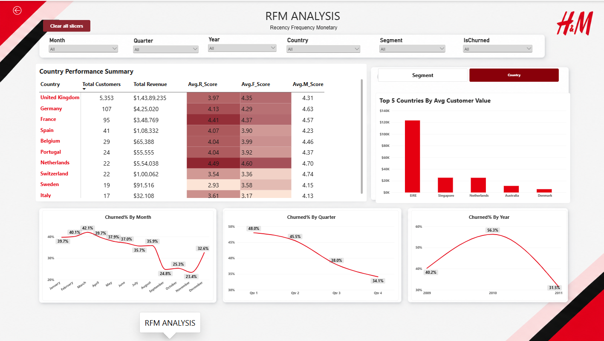

# H&M Home \| Customer Analytics & RFM Segmentation

**An end-to-end retail customer analytics portfolio project using SQL,
Python, and Power BI**

**Project focus:** Retail Analytics · Customer Behaviour · RFM
Segmentation · Customer Retention · Business Intelligence

------------------------------------------------------------------------

## Project Overview

This project explores customer purchasing behaviour for a **fictional
H&M Home-inspired retail business scenario**. Using transactional retail
data, the analysis aims to understand customer value, identify different
purchasing behaviours, and highlight customer groups that may need
targeted engagement or retention strategies.

The project follows an end-to-end analytics workflow:

**Raw Transaction Data → SQL Data Preparation → Python RFM Analysis →
Customer Segmentation → Power BI Reporting → Business Recommendations**

The objective is to demonstrate how raw retail transactions can be
transformed into structured customer-level insights that support
business decision-making.

> **Important:** H&M Home is used only as the fictional business context
> for this educational portfolio project. The dataset does not contain
> actual H&M or H&M Home transactions, customers, or business
> performance information.

------------------------------------------------------------------------

## Business Scenario

Imagine supporting the analytics team of a home and lifestyle retailer.
The business processes a large volume of customer transactions but does
not have a clear, structured view of customer value or purchasing
behaviour.

Some customers purchase frequently and contribute a substantial share of
revenue, while others purchase occasionally or have not returned for an
extended period. Without customer segmentation, the business may rely on
broad marketing campaigns rather than directing engagement efforts
toward the customers and segments that need them most.

This project uses transaction history to explore customer value,
purchasing patterns, and inactivity, then translates the analysis into
practical customer engagement ideas.

## Business Objectives

-   Identify high-value customers and understand their contribution to
    revenue.
-   Segment customers based on Recency, Frequency, and Monetary value.
-   Identify customers who have not purchased within a defined
    inactivity period.
-   Compare customer and revenue performance across segments.
-   Explore revenue and purchasing trends over time and across
    countries.
-   Develop practical engagement and retention recommendations for
    different customer groups.

## Key Business Questions

### Customer Behaviour

-   How many identifiable customers made purchases?
-   How recently did customers make their last purchase?
-   How frequently do customers place orders?
-   How much revenue has each customer generated?

### Customer Segmentation

-   How are customers distributed across RFM segments?
-   Which segments contribute the most revenue?
-   How does average customer value differ between segments?
-   Which customer groups may need additional engagement?

### Retention

-   How many customers have been inactive for more than 90 days?
-   Which segments contain the largest number of inactive customers?
-   Which groups could be prioritized for re-engagement campaigns?

### Retail Performance

-   How does revenue change over time?
-   How does customer and revenue contribution vary by country?
-   Are there periods with higher purchasing activity?

------------------------------------------------------------------------

## Dataset

**Dataset:** Online Retail II\
**Source:** UCI Machine Learning Repository\
**Original business context:** A UK-based, non-store online retailer
selling giftware and home-related products.

The dataset contains transactional records spanning December 2009 to
December 2011. It includes invoice numbers, product codes, product
descriptions, quantities, invoice dates, unit prices, customer
identifiers, and countries.

The two source files contain **1,067,371 rows in total**:

  Source file                                 Rows
  -------------------------------- ---------------
  Online Retail II -- 2009--2010           525,461
  Online Retail II -- 2010--2011           541,910
  **Total**                          **1,067,371**

The source data includes common retail data-quality challenges such as
missing customer identifiers, non-positive quantities, missing
descriptions, duplicate records, and inconsistent date formats.

**Dataset note:** The Online Retail II dataset is used as a proxy
dataset for the fictional H&M Home-inspired business scenario. No actual
H&M customer or sales data is used.

------------------------------------------------------------------------

## Tools & Technologies

  -----------------------------------------------------------------------
  Tool / Technology                   Purpose
  ----------------------------------- -----------------------------------
  SQL Server                          Data combination, type conversion,
                                      data-quality checks, deduplication,
                                      and preparation

  SQL Server Management Studio (SSMS) SQL development and execution

  Python                              RFM calculations and customer
                                      segmentation

  Pandas                              Data manipulation, aggregation, and
                                      merging

  Jupyter Notebook                    Python analysis environment

  Power BI Desktop                    Business intelligence reporting and
                                      data visualization

  DAX                                 Power BI measures and analytical
                                      calculations

  CSV / Excel                         Data exchange between SQL, Python,
                                      and Power BI
  -----------------------------------------------------------------------

------------------------------------------------------------------------

## Project Workflow

### Step 1 --- Data Import and SQL Preparation

The two Online Retail II source files were imported into SQL Server as
separate tables.

The source tables were combined into a unified transaction table using
`UNION ALL`. During this process:

-   Invoice dates were converted using `TRY_CONVERT()` with multiple
    date-format styles.
-   `COALESCE()` was used to select the successful date conversion.
-   Unit prices were converted to a decimal data type.
-   A source-sheet field was added to preserve the origin of each
    record.
-   The combined row count and failed date and price conversions were
    checked.

### Step 2 --- SQL Data Quality Checks and Deduplication

The combined data was examined for common data-quality issues:

-   Missing customer identifiers.
-   Zero or negative quantities.
-   Missing product descriptions.
-   Exact duplicate transaction rows.

Duplicate records were identified by grouping on the transaction fields
and checking for groups with more than one occurrence. `ROW_NUMBER()`
with a matching `PARTITION BY` definition was then used to retain one
record from each exact-duplicate group and create the cleaned table.

The SQL preparation produced the cleaned transaction table,
`RetailCleaned`, for downstream analysis.

**Important processing distinction:** Missing customer IDs and
non-positive quantities were checked in SQL but were not deleted from
`RetailCleaned` by the deduplication query. They were excluded later
from the customer-level RFM calculation.

### Step 3 --- Python RFM Analysis

The cleaned transaction data was loaded into Python using pandas. For
RFM analysis, records without a customer ID and records with zero or
negative quantities were excluded so that customer purchase behaviour
was calculated from positive-quantity transactions with an identifiable
customer.

A reference date of **10 December 2011** was used as the RFM snapshot
date.

The three RFM dimensions were calculated as follows:

  -----------------------------------------------------------------------
  Metric                  Calculation             Interpretation
  ----------------------- ----------------------- -----------------------
  Recency                 Days between the        How recently the
                          snapshot date and the   customer purchased
                          customer's latest       
                          invoice date            

  Frequency               Number of distinct      How often the customer
                          invoices per customer   purchased

  Monetary                Sum of quantity         Historical transaction
                          multiplied by unit      value attributed to the
                          price                   customer
  -----------------------------------------------------------------------

Each customer received a score from 1 to 5 for Recency, Frequency, and
Monetary value using quintile-based scoring.

-   **Recency:** Lower days since the last purchase receive a higher
    score.
-   **Frequency:** More distinct invoices receive a higher score.
-   **Monetary:** Higher total spend receives a higher score.

### Step 4 --- Customer Segmentation

RFM scores were translated into six customer segments using rule-based
conditions:

  -----------------------------------------------------------------------
  Segment                             General interpretation
  ----------------------------------- -----------------------------------
  Champions                           Recent, frequent, and high-spending
                                      customers

  Loyal                               Customers with relatively strong
                                      recency and frequency scores

  At Risk                             Customers with lower recency scores
                                      but a history of purchasing

  New                                 Recently active customers with
                                      lower frequency scores

  Needs Attention                     Customers with moderate recency and
                                      lower frequency scores

  Lost                                Customers who do not meet the
                                      conditions for the other segments
  -----------------------------------------------------------------------

A customer inactivity flag was also created:

`IsChurned = Recency > 90`

This identifies customers whose last recorded purchase was more than 90
days before the snapshot date. It is an **inactivity-based churn
proxy**, not a predictive churn model.

### Step 5 --- Preparing the Power BI Dataset

The customer-level RFM results were merged back onto the filtered
positive-quantity transaction data using `Customer_ID`.

The resulting dataset included transaction fields alongside
customer-level Recency, Frequency, Monetary value, RFM scores, segment,
and inactivity flag. An invoice-month field and transaction revenue
field were also created for reporting.

The final dataset was exported to Excel as `EcommerceDashboardData.xlsx`
for use in Power BI.

------------------------------------------------------------------------

## RFM Methodology

RFM analysis is a customer segmentation technique that evaluates three
aspects of historical purchasing behaviour.

  Dimension   Business question
  ----------- ---------------------------------------
  Recency     When did the customer last purchase?
  Frequency   How often has the customer purchased?
  Monetary    How much has the customer spent?

The combined RFM scores help distinguish customers with different levels
of engagement and historical value. The project uses rule-based segment
assignment, so each segment is determined by the scoring conditions
documented in the Python notebook.

**Scoring direction matters:** A higher Recency score represents a more
recent purchase, while higher Frequency and Monetary scores represent
more purchases and greater historical spend.

------------------------------------------------------------------------

## Power BI Reporting

The cleaned and enriched Excel dataset is prepared for Power BI
reporting. The report is intended to present customer and revenue
performance in an accessible, interactive format.

The planned report areas are:

-   **Business Overview:** headline customer and revenue KPIs, customer
    segment distribution, and time-based performance.
-   **Customer & RFM Analysis:** segment-level customer counts, revenue
    contribution, average customer value, RFM scores, and inactivity
    analysis.
-   **Navigation and exploration:** report navigation and relevant
    filters to help users explore the data.

The full interactive report file (`hm_sales_dashboard.pbix`) is included directly in this repository. Key dashboard views are shown below:

### Business Overview Dashboard


### Customer & RFM Segmentation Dashboard


------------------------------------------------------------------------

## Business Recommendations Framework

The RFM segments can help the business tailor customer engagement rather
than treating every customer in the same way.

  -----------------------------------------------------------------------
  Segment                             Potential business action
  ----------------------------------- -----------------------------------
  Champions                           Reward loyalty through early
                                      access, exclusive collections, or
                                      VIP benefits.

  Loyal                               Encourage repeat purchases through
                                      loyalty incentives and relevant
                                      product recommendations.

  New                                 Build the relationship with welcome
                                      communication and incentives for a
                                      second purchase.

  Needs Attention                     Re-engage customers with
                                      personalized recommendations based
                                      on previous purchases.

  At Risk                             Prioritize targeted win-back
                                      campaigns and monitor response.

  Lost                                Assess the potential value of
                                      reactivation before spending
                                      heavily on retention campaigns.
  -----------------------------------------------------------------------

These are proposed strategies based on the segment definitions. Their
effectiveness would need to be tested using campaign and customer
response data.

------------------------------------------------------------------------

## Repository Structure

The repository is organized around the three stages of the analytics
workflow:

```text
H&M_Home-Customer-Analytics/
│
├── images/                  # Exported dashboard screenshots for README preview
│   ├── Overview_page.png
│   └── RFM_analysis_page.png
│
├── ecommerce_analysis.sql   # SQL data cleaning, type conversion, and deduplication
├── hm_sales_dashboard.pbix  # Interactive Power BI report file
├── rfm_segmentation.ipynb   # Python notebook for RFM quintiles and segmentation
└── README.md                # Project documentation and business recommendations
```


------------------------------------------------------------------------

## How to Reproduce the Project

1. **Download Data:** Get the Online Retail II dataset from the [UCI Machine Learning Repository](https://archive.ics.uci.edu/dataset/502/online+retail+ii).
2. **SQL Preparation:** Execute `ecommerce_analysis.sql` in SQL Server to combine sheets, perform data-quality checks, remove duplicates, and export the cleaned transaction table (`RetailCleaned.csv`).
3. **RFM Analysis:** Run `rfm_segmentation.ipynb` in Jupyter Notebook to compute RFM quintile scores, generate customer segments, apply the 90-day inactivity churn proxy, and export the enriched reporting dataset.
4. **Power BI Reporting:** Open `hm_sales_dashboard.pbix` in Power BI Desktop and point the data source to your exported dataset to interact with the dashboards.
------------------------------------------------------------------------

## Data Source & Acknowledgement

The project uses the **Online Retail II** dataset from the UCI Machine
Learning Repository.

The dataset was donated by Daqing Chen and contains anonymized
transactional records from a UK-based online retailer.

Please refer to the original UCI dataset page for the source files,
citation information, and licence terms:

[UCI Machine Learning Repository -- Online Retail
II](https://archive.ics.uci.edu/dataset/502/online+retail+ii)

------------------------------------------------------------------------

## Project Disclaimer

H&M Home is used as a fictional business scenario for this independent
educational portfolio project. This project is not affiliated with,
endorsed by, or representative of H&M Group or H&M Home.

All analysis is based on the public Online Retail II dataset. The
dataset does not contain actual H&M customer, product, or sales data.
Any business interpretations and recommendations are illustrative and
should not be interpreted as actual company performance or strategy.

------------------------------------------------------------------------

## Skills Demonstrated

-   SQL: data combination, type conversion, data-quality checks,
    duplicate detection, and data preparation.
-   Python: pandas, aggregation, feature creation, quintile scoring, and
    rule-based segmentation.
-   Customer Analytics: RFM analysis, customer value analysis, and
    inactivity-based churn flagging.
-   Power BI: report development and business performance visualization.
-   Business Analysis: translating customer behaviour into actionable
    engagement and retention recommendations.

------------------------------------------------------------------------

**Author:** \   Gauri Ashok Pernekar \
**Project:** H&M Home -- Customer Analytics & RFM Segmentation\
**Tools:** SQL Server · Python · Pandas · Power BI · DAX\
**Project Type:** End-to-End Data Analytics Portfolio Project
